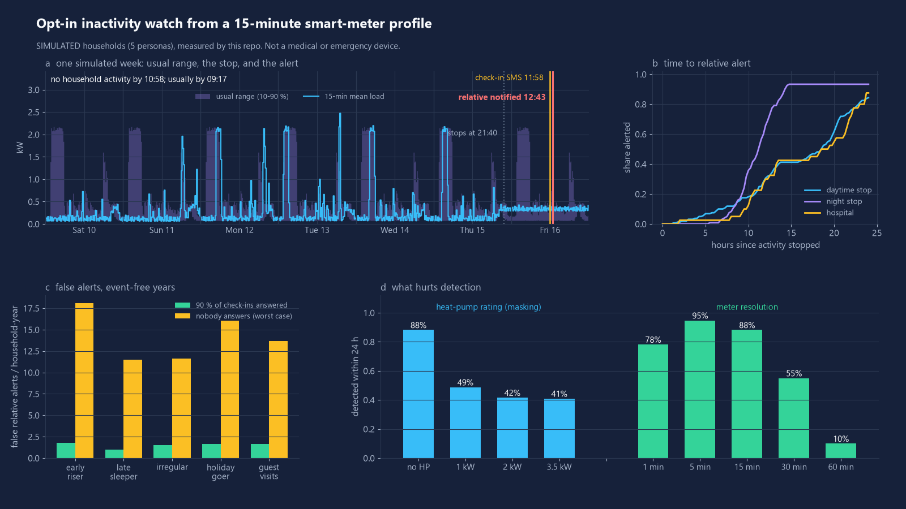

# meter-wellbeing-watch

Open-source, opt-in watch-over service that notices unusual inactivity from a 15-minute smart-meter profile, asks the person first, and only then notifies a relative, with a plain-text reason.

**Not a medical or emergency device. Simulated data only. Nothing here calls emergency services.**



## What it does

1. **Edge features.** A burst filter turns the household load into "activity slots" (kettle, hob, microwave scale bursts survive; long plateaus such as boiler, TV and lights cancel out). Only derived daily-routine numbers are meant to leave the home (`wellbeing_watch/privacy.py` enforces a scalar-only payload and a 31-day retention bound).
2. **Routine model.** A Student-t predictive over the usual time of first morning activity (14-day learning period, 28-day window). The alert time is the predictive quantile plus a margin, so irregular households get later alerts.
3. **Escalation.** Missing morning activity (or an unusually long gap) triggers a check-in SMS to the person; no reply within the wait time notifies a relative. A reply of "ok" cancels, "away" starts away mode. Declared absences suppress alerts.
4. **Consent.** Processing is refused before the consent date and stops (model cleared) on withdrawal.
5. **Local clock.** Wall-clock handling across daylight-saving days (23 h and 25 h days) is tested.

## Measured results (simulated)

Source: `results/results.json` (raw rows in `results/results.csv`). 40 simulated households (5 personas x 8), 8 injected events each (320 events), 330 scored days per household (36.2 household-years); the first 35 days are learning and not scored. Reproduce with `python -m wellbeing_watch demo --households 8 --events 8`.

Base case: household without heat pump, 15-minute data.

| Metric | Value |
|---|---|
| Stops alerted to a relative within 24 h | 88% |
| Median / p90 time from stop to relative alert | 12.0 h / 21.4 h |
| False relative alerts per household-year, 9 in 10 check-ins answered | 1.52 |
| False relative alerts per household-year, nobody ever answers (worst case) | 14.2 |
| Check-in SMS per household-year | 18.3 |

By event: night falls 93% (median 11.0 h), hospital stays 88% (17.2 h), daytime falls 84% (16.0 h). Late sleepers are hardest (70% detection).

**Heat-pump masking.** Heat-pump cycles look like activity bursts. Detection within 24 h: 88% (none), 49% (1 kW), 42% (2 kW), 41% (3.5 kW); in winter months 87% falls to 27% with a 2 kW or larger unit.

**Meter resolution** (boiler only): 1 min 78%, 5 min 95%, 15 min 88%, 30 min 55%, 60 min 10%. Hourly data is not enough. The drop at 1 minute versus 5 minutes is not smoothed away: finer data also exposes more non-human bursts under the same thresholds, so the thresholds were not tuned per resolution.

**Daylight saving.** A fixed-offset clock changes false alerts only marginally in this simulation (1.47 versus 1.52 per year); the local-clock handling is kept for correctness.

## What is unverified

- No real household, no real meter data, no real SMS replies: persona behaviour and the 90% reply rate are assumptions.
- Event types and the heat-pump model are simulator choices; real appliances will differ.
- No clinical, legal or data-protection review. Swiss/EU consent and retention rules need a real review before any deployment.
- Thresholds were set once and checked on the same simulator, so figures are optimistic compared with the field.

## Use

```bash
pip install -e ".[dev]"
python -m wellbeing_watch simulate --persona early_riser --days 120 --out sim.csv
python -m wellbeing_watch watch sim.csv --consent-given 2024-12-01
python -m wellbeing_watch demo --quick --no-figures     # smoke test
pytest -q && ruff check .
```

`watch` expects a CSV with columns `timestamp_utc, mean_w`.

## Layout

`wellbeing_watch/` clock, simulator, features, detector, privacy, evaluate, figures, cli. `tests/` unit tests. `results/` measured output. `docs/` figures and LinkedIn text.

MIT licence.
